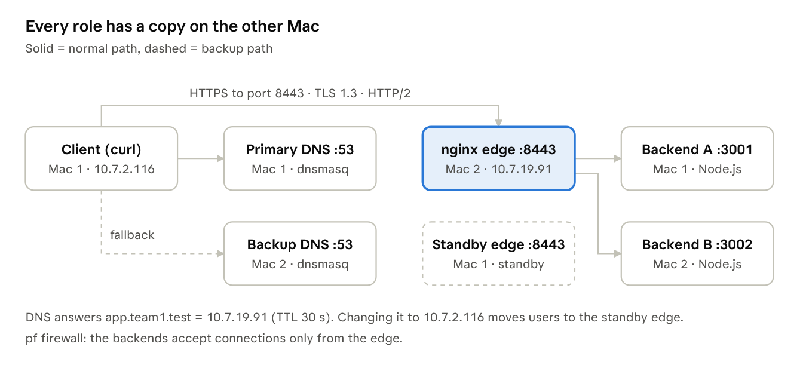

# Phase 2 Report — Team 1: A Fault-Tolerant Local Web Service

November 23, 2026

**Team 1** — Mac 1: Mansi (10.7.2.116) · Mac 2: Tanisha (10.7.19.91)

***Abstract***—In Phase 1 we built a small web service on two MacBooks: our own DNS server, an HTTPS reverse proxy (nginx) and two backend servers. In Phase 2 we made this service keep working when parts of it fail. We added a backup DNS server, short DNS cache times (TTL = 30 s), firewall rules that hide the backends, automatic backend failover, and a standby proxy that we can switch to by changing one DNS record. We tested every feature by breaking something on purpose and recording what happened. All tests passed. The site kept answering with HTTP 200 when one DNS server or one backend was down, and it returned a clear 502 error only when both backends were down. One limit remains: the campus firewall on Mac 1 blocks incoming DNS (port 53), so we ran the backup DNS on Mac 2.

***Index Terms***—DNS, dnsmasq, TTL, nginx, reverse proxy, load balancing, high availability, failover, TLS 1.3, HTTP/2, packet filter (pf), Wireshark.

## I. Introduction

Phase 2 asks one question: does our service still work when something breaks? In Phase 1, every part ran only once. If the DNS server, a backend or the proxy stopped, users could not reach the site.

In Phase 2 we added six extensions (A to F), as the project brief asks [1]:

1. **A — Backup DNS:** a second DNS server answers when the first one is down.
2. **B — TTL control:** DNS answers are cached for only 30 seconds, so changes reach clients fast.
3. **C — Service isolation:** firewall rules let only the proxy talk to the backends.
4. **D — HA failover:** nginx stops sending traffic to a dead backend.
5. **E — Edge cutover:** a standby proxy takes over when we change one DNS record.
6. **F — Troubleshooting:** we find faults by checking one network layer at a time.

For each extension we wrote down the setup, broke something on purpose, and saved screenshots, screen recordings and a Wireshark capture. All evidence is in the `evidence/` folder of our GitHub repository [2].

## II. System Architecture

Two MacBooks on the same campus Wi-Fi share the four network roles. Every role now has a backup on the other Mac, except the client.

*Fig. 1. Team 1 topology · 2 Macs, 7 services.* The client finds the edge through DNS, then connects over HTTPS; nginx shares requests between the two backends.

*A. Machines and Roles*

| Machine | IP address | Main roles | Backup roles |
| --- | --- | --- | --- |
| Mac 1 (Mansi) | 10.7.2.116 | Primary DNS (dnsmasq), Backend A (port 3001), test client | Standby nginx edge (port 8443) |
| Mac 2 (Tanisha) | 10.7.19.91 | nginx edge (HTTPS, port 8443), Backend B (port 3002) | Backup DNS (dnsmasq) |

Both Macs use subnet mask 255.255.224.0 (/19) and gateway 10.7.0.1. Our private domain is `team1.test`. The names `app.team1.test` and `api.team1.test` point to the edge at 10.7.19.91.

*B. Path of One Request*

1. The client asks DNS for `app.team1.test` (UDP port 53). Mac 1 asks its own dnsmasq first, then the backup on Mac 2.
2. DNS answers `10.7.19.91` with TTL 30 s.
3. The client opens a TCP connection to 10.7.19.91:8443.
4. TLS 1.3 starts. The client sends the name in SNI and offers HTTP/2 with ALPN.
5. nginx checks the certificate name, decrypts the request and sends it to Backend A or B over plain HTTP.
6. The backend answers. nginx adds the `X-Backend` and `X-Edge` headers and sends the reply back over TLS.

*C. Protocols and Layers*

| Layer (TCP/IP) | What it does in our system |
| --- | --- |
| Application | DNS (dnsmasq), HTTP/2 between client and nginx, HTTP/1.1 between nginx and backends |
| Security (TLS) | TLS 1.3 with a self-signed certificate for `app.team1.test` and `api.team1.test` |
| Transport | UDP 53 for DNS; TCP 8443, 3001 and 3002 for web traffic |
| Network | IPv4 on 10.7.0.0/19; pf firewall rules |
| Link | Wi-Fi (en0); ARP finds the MAC address of the other Mac |

## III. Changes from Phase 1

Before adding new features, we fixed seven problems that we found in our Phase 1 setup.

| # | Problem in Phase 1 | Fix in Phase 2 | Why it matters |
| --- | --- | --- | --- |
| 1 | dnsmasq used `address=`, which always sends TTL 0 | Changed to `host-record=name,ip,30` and `local-ttl=30` | Extension B needs a real TTL to measure |
| 2 | Names in `/etc/hosts` leaked into DNS answers and gave two A records | Removed the old lines and added `no-hosts` | Clients now get exactly one correct IP |
| 3 | Cross-machine DNS (task A3) did not work, because Mac 1 blocks port 53 | Backup DNS on Mac 2; Mac 1 queries Mac 2 | `dig @10.7.19.91` from Mac 1 now returns NOERROR |
| 4 | nginx had no health-check settings | Added `max_fails=1 fail_timeout=10s` and `proxy_next_upstream` | A dead backend is skipped after one failure |
| 5 | Backend B code was missing from the repo, and Backend A was in the wrong folder | Restored `config/backend-b/` and moved Backend A to `config/backend-a/src/` | Anyone can rebuild the system from the repo |
| 6 | Config files were not grouped by machine or phase | New files named `phase2-mac1-primary.conf`, `phase2-mac2-backup.conf`, and so on | Clear which file goes on which Mac |
| 7 | IP addresses changed when we joined a new network | Updated every config to 10.7.2.116 and 10.7.19.91; Phase 1 files keep the old IPs to match old evidence | The configs match the live system |

We also added `.gitignore` so the TLS private key (`team1.key`) is never pushed to GitHub. It is shared between the two Macs by AirDrop only.

## IV. Extensions and Results

All six extensions worked. The table gives the short result; each part below explains the test and what we learned.

| Ext. | Feature | Test | Result | Evidence folder |
| --- | --- | --- | --- | --- |
| A | Backup DNS | Stop the primary DNS on Mac 1 | Names still resolve through Mac 2; site returns HTTP/2 200 | `P2-A-backup-dns/` |
| B | TTL = 30 s | Change the DNS record and watch the client | Old answer used until 17:43:24, then new answer; flush skips the wait | `P2-B-E-ttl-and-cutover/` |
| C | Firewall (pf) | Reach a backend directly from the other Mac | Connection times out; the edge path still works; 3 and 30 packets counted | `P2-C-firewall/` |
| D | Backend failover | Kill Backend A | 8 of 8 requests return 200 from Backend B | `P2-D-failover/` |
| E | Standby edge | Point the DNS record at Mac 1 | Traffic moves from `mac2-primary` to `mac1-standby` | `P2-B-E-ttl-and-cutover/` |
| F | Troubleshooting | Find a real fault in the backup DNS | Wrong `listen-address` found and fixed | `P2-F-troubleshooting/` |

### A. Extension A — Backup DNS Resolver

**Setup.** Mac 2 runs a second dnsmasq with the same records. On Mac 1 we set the DNS servers to `127.0.0.1` (own primary) and then `10.7.19.91` (backup).

**Test.** We stopped dnsmasq on Mac 1. `dig @127.0.0.1` gave "connection refused", but a normal lookup still returned `10.7.19.91`, and `curl` still got HTTP/2 200. Then we started the primary again.

**Learned.** The client tries the next server in its list when the first one fails. A second DNS server removes a single point of failure. In Wireshark we also saw that macOS sometimes asks both servers at once: when the second answer comes late, Mac 1 replies with "ICMP port unreachable" because it has already closed that socket.

### B. Extension B — TTL and Caching

**Setup.** Every record has TTL 30 s [8] (`host-record=app.team1.test,10.7.19.91,30`).

**Test.** While a loop on Mac 1 sent one request per second, we changed the record to `10.7.2.116`. The client kept using the old, cached answer (`mac2-primary`) until **17:43:24**, then moved to `mac1-standby`. When we changed it back, we flushed the macOS cache, and the client switched at **17:44:01** with no wait.

**Learned.** TTL is the longest time a change can take to reach a client. A short TTL gives fast changes but more DNS queries; a long TTL gives fewer queries but slow changes. Flushing the cache (`dscacheutil -flushcache`) skips the wait on one machine only.

### C. Extension C — Service Isolation with a Firewall

**Setup.** We used the macOS packet filter (pf). Rules go in our own anchor `com.apple/team1`, so the system rules are never changed.

- Mac 2: `block in quick on en0 proto tcp to any port 3002`
- Mac 1: `pass in` to port 3001 only from `10.7.19.91` (the edge), then `block` all other traffic to 3001

**Test.** From Mac 1, `nc` to `10.7.19.91:3002` **timed out**, but the site through the edge still answered. The rule counters showed 3 packets blocked on Mac 2 and 30 packets passed from the edge on Mac 1 (0 blocked). After rollback (`pfctl -a com.apple/team1 -F all` and `pfctl -X <token>`), `nc` to port 3002 worked again.

**Learned.** A firewall *drop* causes a timeout, not "connection refused". Clients can now reach the backends only through the edge. nginx reaches Backend B through `127.0.0.1`, which does not use `en0`, so the rule does not block it.

### D. Extension D — High-Availability Failover

**Setup.** `server 10.7.2.116:3001 max_fails=1 fail_timeout=10s;` and the same for Backend B. `proxy_next_upstream error timeout http_502 http_503 http_504;` with `proxy_next_upstream_tries 2`.

**Test.** We found Backend A with `lsof -iTCP:3001` and stopped it. The next 8 of 8 requests returned 200 from Backend B. The nginx error log showed only **one** "Connection refused" line for 10.7.2.116:3001. After a restart, A and B alternated again.

**Learned.** nginx [9] uses *passive* health checks: it marks a backend as down after a real request fails. With `max_fails=1` it skips that backend for 10 s, so users see no error. `proxy_next_upstream` retries the failed request on the other backend.

### E. Extension E — DNS-Based Edge Cutover

**Setup.** A standby nginx on Mac 1 uses the same certificate and the same two backends. It adds the header `X-Edge: mac1-standby`; the main edge adds `X-Edge: mac2-primary`.

**Test.** First we tested the standby directly with `curl --resolve` (HTTP/2 200, A and B balanced). Then we changed `app.team1.test` to `10.7.2.116` on both DNS servers. After the TTL ran out, all requests went to `mac1-standby`. We then changed the record back.

**Learned.** DNS can move users to a different server without any change on the client. The same certificate works on both edges because it is bound to the *name*, not the IP address. The switch is not instant: it takes up to one TTL.

### F. Extension F — Layer-by-Layer Troubleshooting

**Fault we met.** During testing, `dig @10.7.19.91` timed out. We went up the layers:

1. `ping 10.7.19.91` worked, so the network was fine.
2. `dig` timed out, so the DNS service was not answering.
3. We checked the service: dnsmasq was not running.
4. The config on Mac 2 had Mac 1's `listen-address`. With `bind-interfaces`, dnsmasq cannot listen on an IP it does not own, so it would not start.
5. We copied back `phase2-mac2-backup.conf` and restarted. `dig` worked again.

**Our method.** `ping` (IP) → `dig` (DNS) → `nc -vz host port` (TCP) → `openssl s_client` (TLS) → `curl -v` (HTTP) → logs in `/tmp/team1-*.log`.

## V. Failure Scenarios

We broke the system in four ways. Each failure gives a different symptom, and the symptom tells us which layer is broken.

| Failure | What we did | What the client saw | Layer at fault | Evidence |
| --- | --- | --- | --- | --- |
| Wrong DNS record | Changed `app.team1.test` to `10.7.19.99` (no host there) | `dig` gave the wrong IP; `curl` **timed out** after 5 s | DNS (wrong data) | `P1-failures/02-wrong-dns-record.png` |
| Wrong DNS server | Mac 1 used only `8.8.8.8` | `SERVER: 8.8.8.8`, no answer for `team1.test` | DNS (wrong server) | `P2-A-backup-dns/01-…png` |
| Both backends down | Stopped Backend A and Backend B | **HTTP/2 502** from `mac2-primary` | Application (backends) | `P1-failures/03-…png`, `03b-…png` |
| Wrong port | `curl` to port 9443 instead of 8443 | `ping` worked; `curl` gave **Connection refused** | Transport (port) | `P1-failures/04-wrong-port.png` |

*How to read the symptoms:*

- **Timed out** = the packet got no answer. Either no host has that IP, or a firewall dropped it.
- **Connection refused** = the host is there, but no program listens on that port. The host sent back a TCP RST.
- **502 Bad Gateway** = TLS and nginx work, but nginx could not reach any backend. The edge log shows both tries in one request (`*323`, 00:36:16): first `127.0.0.1:3002` refused, then `10.7.2.116:3001` refused.
- **No answer from a public DNS** = the name is private (`.test`), so only our own DNS servers know it.

## VI. Packet Analysis

One Wireshark capture on Mac 2 shows the full request from Mac 1: DNS, then TCP, then TLS, then encrypted HTTP/2 [7], [10]. We saved only the 85 team packets as `P2-captures/phase2-dns-tcp-tls.pcapng`, using the display filter `ip.addr==10.7.2.116 && (dns.qry.name contains "team1" || tcp.port==8443)`.

| Step | Packets (saved file) | What we see | What it means |
| --- | --- | --- | --- |
| DNS | 4624, 4625 | Query `A app.team1.test`; answer `10.7.19.91`, TTL 30, about 5 ms | UDP port 53, no connection needed [3] |
| TCP handshake | 4639, 4640, 4641 | `SYN` → `SYN, ACK` → `ACK` | Connection opens before any data [4] |
| TLS start | 4642 | Client Hello with SNI `app.team1.test` and ALPN `h2`, `http/1.1` | Name and HTTP version are sent in clear text |
| TLS reply | 4644 | Server Hello, cipher `TLS_CHACHA20_POLY1305_SHA256`, version TLS 1.3 | Everything after this is encrypted [6] |
| Data | 4647–4665 | Only "Application Data" | The HTTP request and response are hidden |
| Close | 4668–4673 | `FIN, ACK` from both sides at the same time | Normal "simultaneous close" |

The packet numbers above are from the original capture. In the saved file the same packets are numbered 1–85, in the same order. The screenshots in `P2-captures/` come from an earlier run of the same test, so their packet numbers are 2379–2387.

*Details we can explain:*

- **Ports and socket pairs.** Each `curl` got a new ephemeral port from macOS: 57337, 57338, 57339. The server port is always 8443. So one connection is `10.7.2.116:57337 ↔ 10.7.19.91:8443`.
- **Sequence numbers.** Wireshark shows `Seq=0`, but this is a relative number. The real first number is random (for example 2837597931). This protects against fake packets.
- **MSS = 1460.** A Wi-Fi/Ethernet frame carries 1500 bytes; minus 20 bytes of IP header and 20 bytes of TCP header leaves 1460 bytes of data.
- **Flow control.** Each side sends its window size (`Win=65535` and `Win=14480`, scaled by `WS=64`). This tells the other side how much data it can send before waiting for an ACK.
- **ECN.** The flags `SYN, ECE, CWR` mean Mac 1 offers Explicit Congestion Notification [5]; Mac 2 accepts with `SYN, ACK, ECE`.
- **TLS 1.3 version field.** The Client Hello says "TLS 1.2 (0x0303)" for old-device compatibility. The real version is chosen in the `supported_versions` extension, and the Server Hello picks TLS 1.3 (0x0304).
- **Why the certificate is not visible.** In TLS 1.3 the certificate is sent after the Server Hello, inside encrypted records. In TLS 1.2 it was visible.

## VII. Limitations

Our system is more reliable than in Phase 1, but four limits remain.

1. **Port 53 is blocked on Mac 1.** The campus device-management firewall drops incoming DNS on Mac 1, and only the IT team can change it. So Mac 2 cannot use Mac 1's DNS: its lookups wait 2 s (the `timeout` in `/etc/resolver/team1.test`) and then use its own backup. Mac 1 itself works fully, so we run the client tests from Mac 1.
2. **Edge failover is manual.** Moving users to the standby edge needs a person to change the DNS record, and then up to 30 s (one TTL). A real system would use a health checker or a floating IP to do this automatically.
3. **Passive health checks only.** nginx finds a dead backend only after a real user request fails. That request is retried, so the user sees no error, but a slow backend is noticed late.
4. **Self-signed certificate and one network.** Each client must trust our certificate by hand. Both Macs are on the same Wi-Fi, so a Wi-Fi outage stops everything; this is a single point of failure we cannot remove with two laptops.

In a cloud setup, these roles map to managed services: a DNS service with health checks (for example Route 53), a load balancer with active health checks, security groups instead of pf, and a certificate from a public CA.

## VIII. Conclusion

In Phase 2 our service survived every single failure we tested. A stopped DNS server, a stopped backend and a moved edge all left the site working (HTTP 200). Only when both backends were down did users get an error, and it was a clear 502, not a hang.

The main lessons are simple. Every role needs a copy on another machine. TTL decides how fast a change reaches users. A firewall drop looks like a timeout, while a closed port looks like "connection refused". When something breaks, check one layer at a time, from `ping` up to the logs.

Next, we would add active health checks and automatic DNS failover, so that no person is needed to move traffic.

## References

[1] Computer Networks Course, "CN Project Document (Phase 1 and Phase 2)," course handout, 2026.

[2] Team 1, "CN_Project_Elite" GitHub repository, 2026. [Online]. Available: <https://github.com/Aggarwalmansi/CN_Project_Elite>

[3] P. Mockapetris, "Domain Names — Implementation and Specification," RFC 1035, IETF, Nov. 1987.

[4] W. Eddy, Ed., "Transmission Control Protocol (TCP)," RFC 9293, IETF, Aug. 2022.

[5] K. Ramakrishnan, S. Floyd and D. Black, "The Addition of Explicit Congestion Notification (ECN) to IP," RFC 3168, IETF, Sep. 2001.

[6] E. Rescorla, "The Transport Layer Security (TLS) Protocol Version 1.3," RFC 8446, IETF, Aug. 2018.

[7] M. Thomson and C. Benfield, Eds., "HTTP/2," RFC 9113, IETF, Jun. 2022.

[8] S. Kelley, "dnsmasq — A lightweight DHCP and caching DNS server," manual page. [Online]. Available: <https://thekelleys.org.uk/dnsmasq/docs/dnsmasq-man.html>

[9] nginx, "Module ngx_http_upstream_module" and "Module ngx_http_proxy_module," documentation. [Online]. Available: <https://nginx.org/en/docs/>

[10] Wireshark Foundation, "Wireshark User's Guide." [Online]. Available: <https://www.wireshark.org/docs/>
